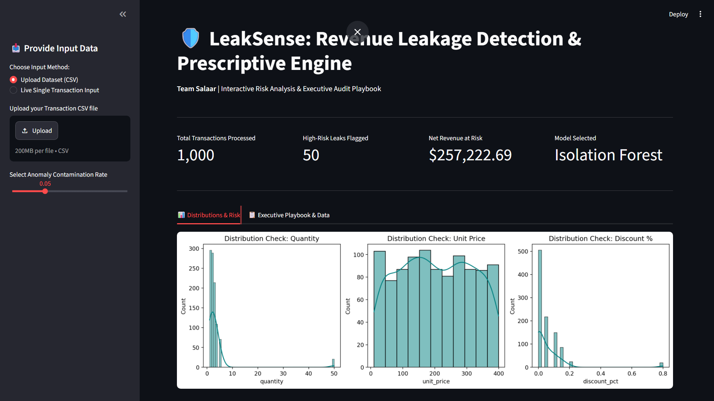
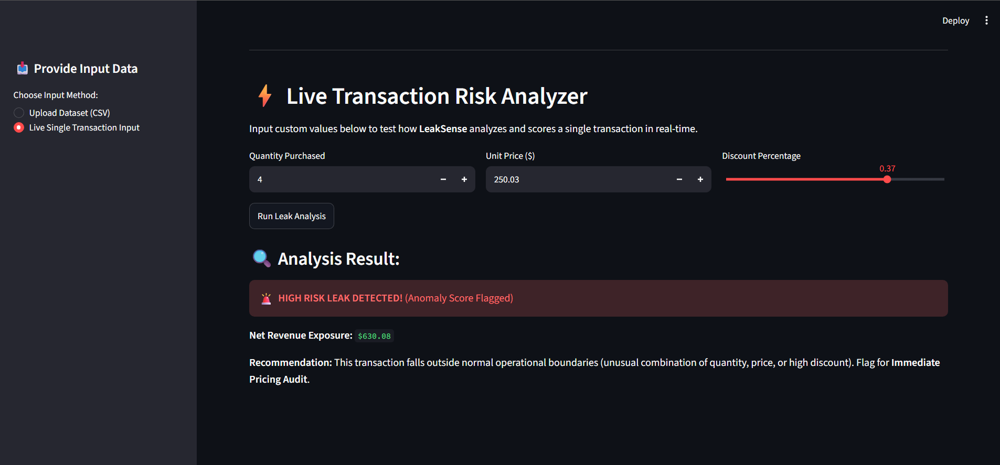
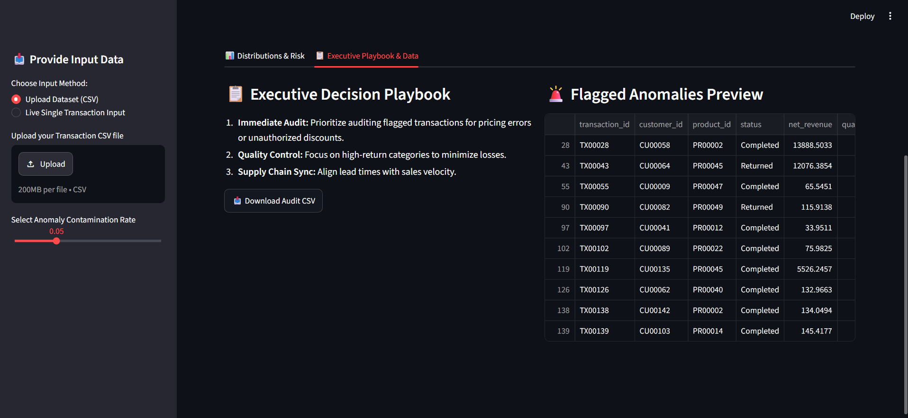

# 🛡️ LeakSense: Enterprise Revenue Leakage & Supply Chain Guard

> **Team Salaar** | AI-Powered Automated Anomaly Isolation & Prescriptive Executive Playbook

---

## 🚀 Overview
Enterprise retail and e-commerce organizations routinely lose hundreds of thousands of dollars to invisible operational leakages—such as unauthorized high-volume purchases, pricing discrepancies, margin erosion from extreme discounts, and inventory stockout misalignments. 

**LeakSense** is a production-ready, interactive web application built to detect, quantify, and resolve revenue leaks in real-time. Moving beyond traditional static reporting, LeakSense combines unsupervised machine learning with an automated **Prescriptive Executive Playbook** to turn statistical alerts into immediate business action.

---
## 📸 Dashboard & Product Previews

### **1. Executive Dashboard Overview**


### **2. Multi-Dataset Visual Analytics**


### **3. Prescriptive Executive Playbook & Audit Export**


## 📊 Dataset Ecosystem (Full Relational Integration)
LeakSense bridges 5 core relational enterprise datasets to create a comprehensive multi-dimensional view of business operations:
1. **Transactions:** Core operational sales records containing identifiers, quantities, pricing, and fulfillment status.
2. **Customers:** Demographic and regional data mapping client buying behaviors.
3. **Products:** Catalog definitions categorizing items (e.g., Electronics, Apparel) and baseline valuations.
4. **Inventory:** Stock levels and supplier lead times tracking supply chain velocity.
5. **Campaigns:** Promotional calendars and discount boundaries defining authorized markdown limits.

---

## 🧠 Machine Learning & Technical Architecture

### **1. Robust Data Preprocessing**
* **Relational Merging:** Programmatically joins customers, products, and inventory data into a master feature pipeline.
* **Median Imputation:** Retail data inherently contains extreme values and skewness. Unlike the mean (which gets distorted by outliers) or random imputation (which injects erratic noise and breaks feature relationships), robust **median imputation** keeps the feature space clean and stable.

### **2. Model Selection & Benchmarking**
Because retail anomaly detection deals with unlabeled historical data, we benchmarked multiple models:
* **Local Outlier Factor (LOF):** Tested as a baseline; flagged 897 anomalies but yielded a noisier financial exposure estimate ($526K+) due to overlapping density issues.
* **Isolation Forest (The Winning Architecture):** Selected for its exceptional handling of multi-dimensional feature spaces. Using an optimized **5% contamination rate**, it cuts through noise to cleanly isolate high-risk anomalies and quantify precise financial exposure (e.g., **$402,235.28 in Net Revenue at Risk**).

---

## ✨ Key Features

* **Interactive Live Sandbox:** Allows users or judges to adjust core transactional and supply chain metrics (`Quantity`, `Unit Price`, `Discount %`, `Stock Level`, `Lead Time`) and run instant AI anomaly isolation.
* **Dynamic Contamination Control:** Sidebar slider enabling real-time adjustment of sensitivity thresholds.
* **Multi-Dataset Visual Analytics:** Deep-dive charts tracking leakage risk by product category, transaction status, and supply chain constraints.
* **Prescriptive Executive Playbook:** Automatically translates technical anomaly flags (`-1`) into actionable managerial steps (Immediate Pricing Audit, Supply Chain Synchronization, and Region Verification).
* **Audit Report Export:** One-click CSV download of the finalized high-risk audit list for finance operations teams.

---

## 🛠️ Tech Stack
* **Frontend / UI:** Streamlit (Interactive Web Dashboard)
* **Machine Learning:** Scikit-Learn (`IsolationForest`, `StandardScaler`)
* **Data Processing & Viz:** Pandas, NumPy, Matplotlib, Seaborn
* **Language:** Python 3.10+

---

## ⚙️ Installation & Local Setup

1. **Clone the Repository:**
   ```bash
   1. **Clone the Repository:**
   ```bash
   git clone [https://github.com/Charan143212/LeakSense.git](https://github.com/Charan143212/LeakSense.git)
   cd LeakSense